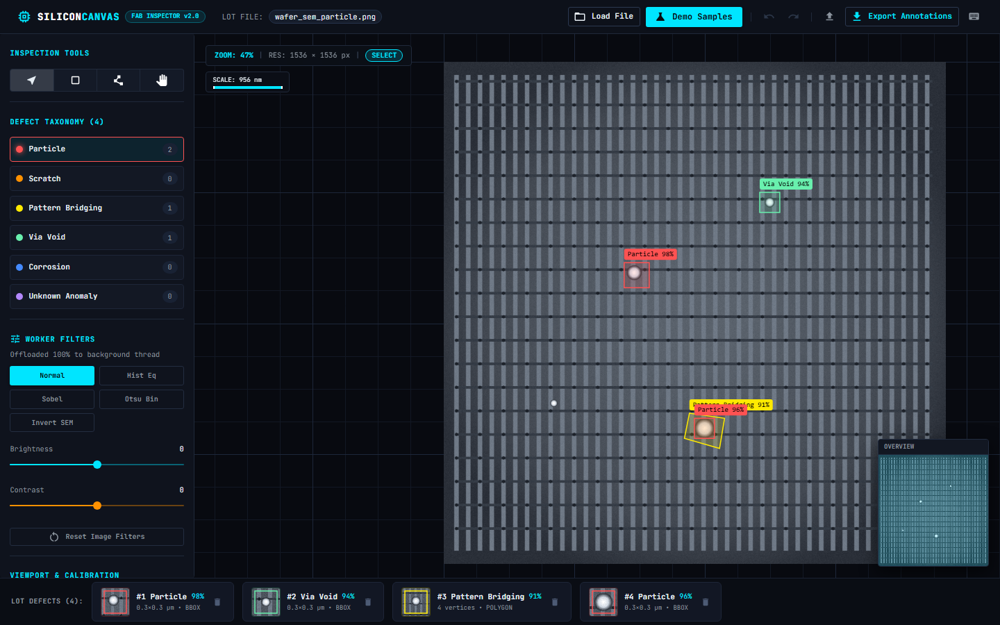
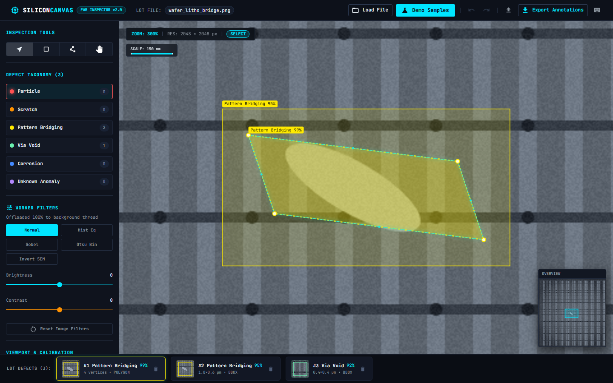
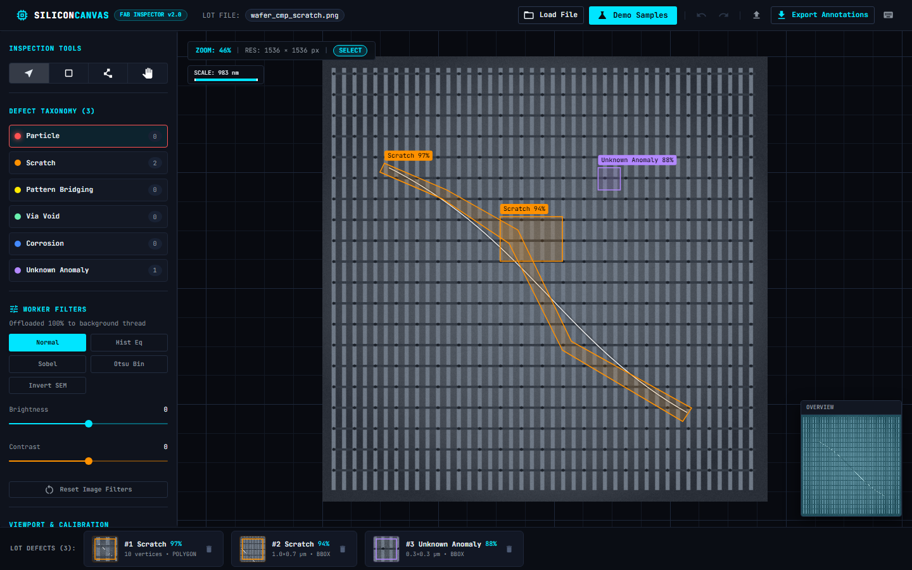
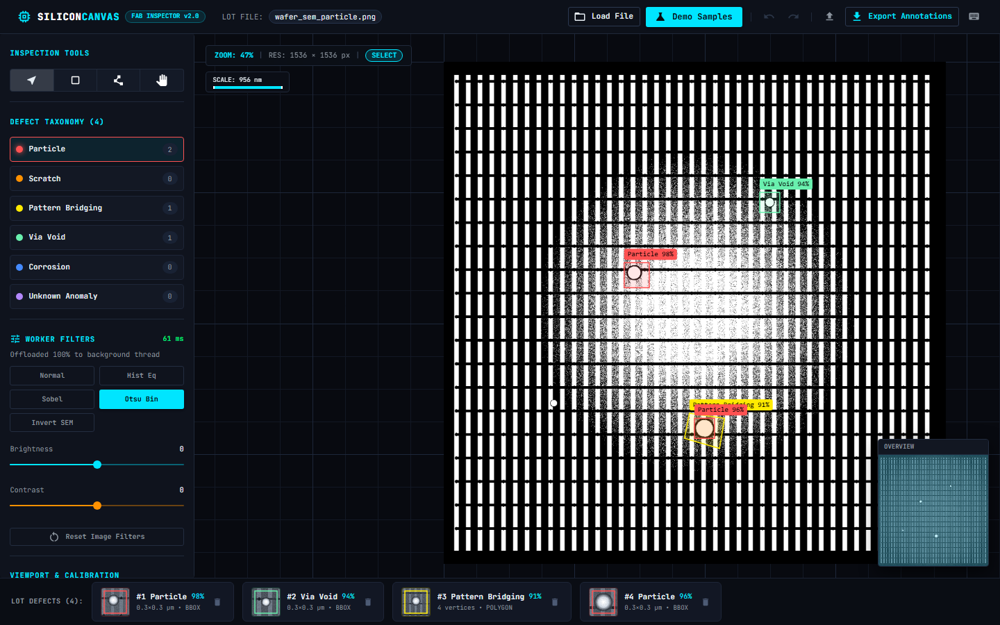
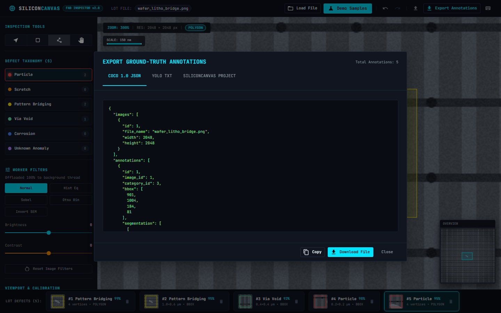

# SiliconCanvas 🔬⚡

[](https://github.com/Rohan-droid7/silicon-canvas)
[](https://github.com/Rohan-droid7/silicon-canvas)
[](https://www.typescriptlang.org/)
[](https://react.dev/)
[](https://vitejs.dev/)
[](https://mui.com/)
[](https://opensource.org/licenses/MIT)

**SiliconCanvas** is an industrial-grade semiconductor wafer defect inspection and annotation workbench. Engineered for defect metrology engineers, process integration specialists, and computer vision teams in modern semiconductor fabrication plants (fabs) and OSAT cleanrooms.

It provides real-time multi-gigapixel inspection of Scanning Electron Microscope (SEM) and optical wafer micrographs, precision vector annotation tools (AABB bounding boxes and polygonal segmentation masks), off-thread Web Worker image enhancement algorithms, and ground-truth dataset exports (COCO 1.0 JSON and YOLO TXT) for automated defect classification (ADC) retraining.

---

## 📸 Visual Walkthrough

### 1. Industrial Cleanroom Control Room Overview
Real-time inspection view with micro-grid coordinate scale, dynamic HUD, synchronized bird's-eye minimap, and interactive defect card strip with micro-crops.


---

### 2. Defect Metrology & Fly-To Dynamic Inspection
Instant 300% zoom with sub-micron physical scale calibration (150 nm scale bar) focused on photolithographic bridge defects.


---

### 3. CMP Mechanical Micro-Scratch Segmentation
Tracing irregular abrasive micro-scratch defects across wafer bus lines using multi-vertex polygonal segmentation.


---

### 4. Background Web Worker Image Filters (Zero UI Blocking)
Heavy pixel-level transformations (Otsu automated binarization, Sobel edge gradients, histogram equalization) run in a dedicated Web Worker via transferable buffers.


---

### 5. Ground-Truth Dataset Export (COCO 1.0 JSON & YOLO TXT)
Direct export of normalized bounding boxes and polygonal segmentation coordinates for model training pipelines.


---

## 🏗️ Architecture & Core Innovations

### 1. Four-Layer Stacked Canvas Pipeline
To maintain a strict 60 FPS budget during continuous zoom and pan across 4K/8K images with hundreds of vector annotations, the viewport decouples raster rendering from vector overlays:

```
┌─────────────────────────────────────────────────────────────┐
│ Layer 4: HUD & Measurement Overlay (HTML/SVG - 60 FPS)       │ → Micron scale bar, crosshairs, tooltips
├─────────────────────────────────────────────────────────────┤
│ Layer 3: Vector Annotation Canvas (HTML5 Canvas 2D)         │ → Bounding boxes, polygons, anchor handles
├─────────────────────────────────────────────────────────────┤
│ Layer 2: Raster Image Canvas (OffscreenCanvas / Canvas 2D)  │ → SEM/wafer micrographs + worker filters
├─────────────────────────────────────────────────────────────┤
│ Layer 1: Background Grid & Coordinate Canvas                │ → Logarithmic micro-grid & die boundaries
└─────────────────────────────────────────────────────────────┘
```

- **Layer 1 (Background Scale Grid):** Renders dynamic sub-micron grid ticks and die boundaries that scale logarithmically with the current zoom level.
- **Layer 2 (Raster Image Layer):** Draws the base micrograph bitmap with toggleable nearest-neighbor or bilinear interpolation. Only redraws on transform changes or image filter commits.
- **Layer 3 (Vector Annotation Layer):** Re-renders vector geometries, active cursor handles, and polygon preview segments driven by a `requestAnimationFrame` loop with dirty-flag caching.
- **Layer 4 (HUD & Measurement Overlay):** High-precision coordinate readout, current nanometer/micron scale bar, and active tool indicators.

### 2. Concurrency Architecture (Web Worker Pipeline)
Pixel processing algorithms run in an isolated Web Worker (`filter.worker.ts`), transferring pixel buffers via zero-copy `ArrayBuffer` transfer lists:

```
[Main UI Thread]
       │
       │  1. Post filter params + Transferable ArrayBuffer
       ▼
[Web Worker: filter.worker.ts]
       │  2. Compute Sobel Convolutions / Otsu Threshold / Histogram EQ
       │  3. Zero-copy transfer back via Transferable ArrayBuffer
       ▼
[Main Canvas Engine]
       │  4. Fast putImageData to raster layer (maintained at 60 FPS)
```

### 3. Normalized Coordinate Precision Space \([0, 1]\)
All annotations are mathematically stored in normalized relative coordinate space:
$$\begin{aligned}
u &= \frac{x_{\text{image}}}{W_{\text{image}}} \in [0.0, 1.0] \\
v &= \frac{y_{\text{image}}}{H_{\text{image}}} \in [0.0, 1.0]
\end{aligned}$$

This guarantees invariant accuracy regardless of display viewport dimensions, device pixel ratios (DPR), or camera resolution variations.

---

## ⚡ Key Features

- **Infinite Mouse-Centric Pan & Zoom:** Zoom range from `0.1x` to `50.0x` centered strictly on cursor focal coordinates with smooth mouse wheel or middle-click drag navigation.
- **Precision Bounding Box Tool (`B`):** Click-and-drag creation of axis-aligned bounding boxes (AABB) with 8 perimeter resize handles and dynamic directional cursors.
- **Polygon Segmentation Tool (`P`):** Multi-point boundary capture for irregular defect structures (CMP scratches, chemical residues, crystal voids) with live cursor tracking, origin-vertex snapping, and closure via `Enter`.
- **Integrated Defect Taxonomy:** Color-coded classification tags matching SEMI standards:
  - 🔴 `PARTICLE` — Foreign particle contamination
  - 🟠 `SCRATCH` — CMP abrasive mechanical micro-scratch
  - 🟡 `PATTERN_BRIDGING` — Photolithographic bridging / short circuit
  - 🟢 `VIA_VOID` — Incomplete etching / via contact void
  - 🔵 `CORROSION` — Metal interconnect oxidation
  - 🟣 `UNKNOWN_ANOMALY` — Unclassified cleanroom excursion
- **Defect Thumbnail Strip:** Horizontally scrollable strip displaying real-time micro-crops of each defect with class tag, confidence score, and one-click fly-to camera centering.
- **Synchronized Minimap:** High-level die overview with a draggable viewport frustum for immediate macro navigation.
- **Standard ML Format Exporters:**
  - **COCO 1.0 JSON:** Standard object detection and instance segmentation format (`bbox: [x, y, w, h]`, `segmentation: [[x1, y1, ...]]`).
  - **YOLO Normalized TXT:** Space-delimited normalized coordinates (`<class-id> <x_center> <y_center> <width> <height>`).
  - **SiliconCanvas Native Project JSON:** Complete session serialization with calibration and history states.
- **Full Undo/Redo Engine:** State history manager isolated outside the UI state tree with 50-step depth (`Ctrl+Z`, `Ctrl+Y`).
- **Physical Scale Calibration:** Configurable nanometers-per-pixel (`nm/px`) slider enabling real-world micrometer readout of defect areas.

---

## ⌨️ Control Room Keyboard Shortcuts

| Shortcut | Action | Description |
|---|---|---|
| <kbd>V</kbd> | **Select / Edit Tool** | Select defects, move boundaries, or drag handles |
| <kbd>B</kbd> | **Bounding Box Tool** | Click & drag to draw an axis-aligned bounding box |
| <kbd>P</kbd> | **Polygon Tool** | Click sequential vertices; press `Enter` to close |
| <kbd>H</kbd> / <kbd>Space</kbd> | **Pan Mode** | Click & drag to pan the wafer canvas |
| <kbd>1</kbd> | **Fit to Viewport** | Auto-scale wafer to fit viewport with optimal margins |
| <kbd>0</kbd> | **1:1 Native Scale** | Reset zoom to 1.0x native sensor pixel match |
| <kbd>F</kbd> | **Focus Selection** | Zoom and frame selected defect with 20% margin |
| <kbd>Ctrl</kbd> + <kbd>Z</kbd> | **Undo** | Revert last defect addition, deletion, or modification |
| <kbd>Ctrl</kbd> + <kbd>Y</kbd> | **Redo** | Reapply reverted defect modification |
| <kbd>Del</kbd> / <kbd>Backspace</kbd> | **Delete** | Delete currently selected defect annotation |
| <kbd>Esc</kbd> | **Cancel** | Cancel active polygon path or deselect |

---

## 🛠️ Technology Stack

| Component | Technology | Rationale |
|---|---|---|
| **Frontend Framework** | React 18 / 19 | Modular component tree & declarative state binding |
| **Language** | TypeScript 5.6 | Strict compile-time type safety across affine transforms & datasets |
| **State Management** | Zustand 5 | Minimal zero-boilerplate store with zero re-render overhead |
| **UI Design System** | Material UI (MUI v5) | Industrial cleanroom dark theme & accessible controls |
| **Canvas Engine** | HTML5 Canvas 2D | Multi-layer rendering pipeline with 60 FPS requestAnimationFrame |
| **Worker Threads** | Native Web Workers | Zero UI freeze for convolutions, histogram EQ, and Otsu binarization |
| **Build Tooling** | Vite 5 | Instant HMR and optimized production bundling |
| **Test Suite** | Vitest 2 + JSDOM | Fast unit and integration tests with canvas mocking |
| **E2E Automation** | Puppeteer Core | Headless Chrome verification and visual screenshot capture |

---

## 🚀 Getting Started

### Prerequisites
- **Node.js**: >= 18.x (tested on Node 20.x and 22.x)
- **npm** or **pnpm** or **yarn**

### Installation

```bash
# Clone the repository
git clone https://github.com/Rohan-droid7/silicon-canvas.git

# Navigate into project directory
cd silicon-canvas

# Install dependencies
npm install
```

### Development Server

Start Vite with hot module replacement:

```bash
npm run dev
```

Open your browser to `http://localhost:5173/`.

### Run Test Suite

Run the full Vitest suite (23 unit tests covering transform matrices, geometry, worker algorithms, history, and component rendering):

```bash
npm test
```

### Production Build

Build and typecheck the optimized production bundle:

```bash
npm run build
```

Preview the production build locally:

```bash
npm run preview
```

---

## 📁 Repository Structure

```
silicon-canvas/
├── docs/
│   └── screenshots/              # High-resolution verification captures
├── public/
│   └── fixtures/                 # Sample COCO datasets and project fixtures
├── scripts/
│   ├── e2e_comprehensive_audit.cjs  # Automated browser visual audit suite
│   └── e2e_test_and_capture.cjs     # End-to-end integration test runner
├── src/
│   ├── components/
│   │   ├── canvas/               # CanvasViewport, CanvasHUD, Minimap
│   │   ├── dialogs/              # ExportDialog, HotkeyCheatSheet
│   │   └── layout/               # HeaderBar, SideControlDrawer, DefectThumbnailStrip
│   ├── core/
│   │   ├── canvas/               # CanvasEngine, ImageLayerRenderer, VectorLayerRenderer
│   │   ├── history/              # HistoryManager, historyInstance
│   │   └── math/                 # TransformMatrix, geometry
│   ├── hooks/                    # useCanvasEvents, useImageLoader, useWorkerFilter, etc.
│   ├── store/                    # useCanvasStore (Zustand state engine)
│   ├── theme/                    # industrialDarkTheme (MUI custom palette)
│   ├── types/                    # annotation, canvas, dataset, worker types
│   ├── workers/                  # filter.worker.ts, filterAlgorithms.ts
│   └── __tests__/                # Vitest comprehensive unit test suite
├── index.html
├── package.json
├── tsconfig.json
└── vite.config.ts
```

---

## 📄 License

This project is licensed under the [MIT License](LICENSE).
